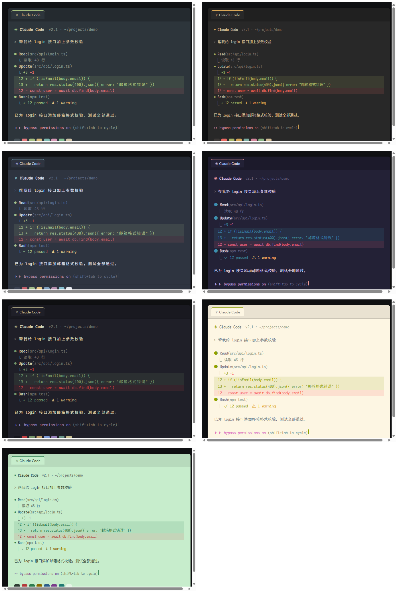
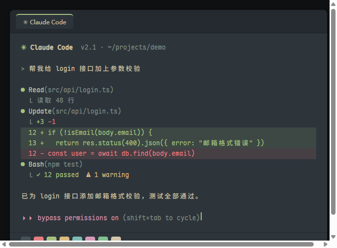
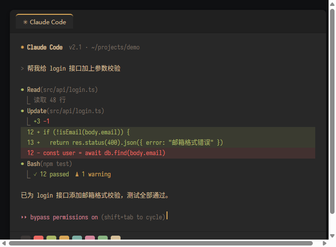
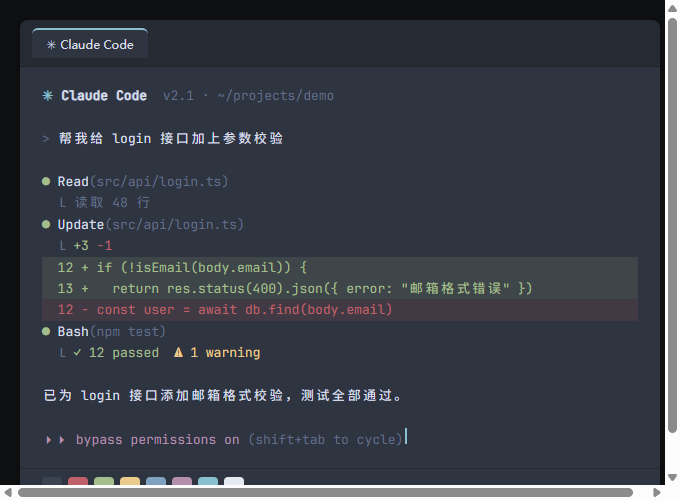
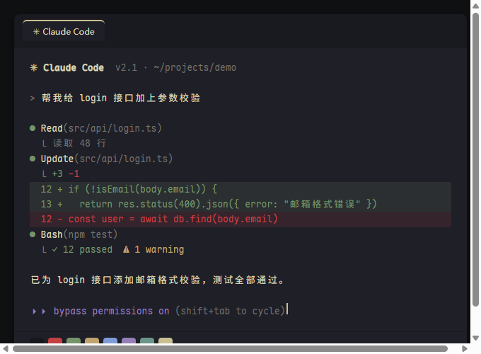
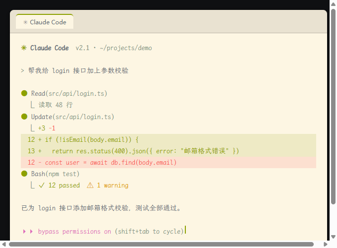

# Claude Code Terminal Setup

> One-click Windows Terminal configuration for Claude Code: curated font × color scheme presets, or DIY custom combinations.

[中文文档](README_CN.md)



## Features

- **7 Curated Presets**: Font and color scheme pairs ready to use
- **4 Programming Fonts**: Chinese-English monospace alignment, open source
- **7 Eye-friendly Color Schemes**: Dark and light themes for different preferences
- **DIY Customization**: Mix and match fonts and colors (28 combinations)
- **Auto Configuration**: Windows Terminal + Claude Code settings in one go
- **Offline Installation**: Reusable font packages, supports air-gapped deployment

## Quick Start

### Local Installation

1. Double-click `preview.html` to preview all themes
2. Double-click `setup.bat`, select a preset number
3. Close all terminal windows and reopen

### Other Machines

1. Copy the entire `claude-terminal-setup` folder to the target machine
2. Double-click `setup.bat`, select a preset
3. First installation downloads fonts (~150MB), may take time on slow networks
4. Close all terminal windows and reopen

## Usage

### Interactive Menu (Recommended)

```cmd
setup.bat
```

Select a preset number (1-7), or enter `diy` for custom mode.

### Command Line

**Install a curated preset:**
```cmd
setup.bat -Preset forest
```

**DIY custom combination:**
```cmd
setup.bat -Font wenkai -Theme paper
```

**Configure Claude Code proxy:**
```cmd
setup.bat -BaseUrl https://your-proxy.com -AuthToken your-key
```

### Parameters

| Parameter | Description | Values |
|-----------|-------------|--------|
| `-Preset` | Curated preset ID | `forest` `craft` `polar` `moon` `wave` `paper` `zen` |
| `-Font` | Font ID (DIY mode) | `maple` `sarasa` `wenkai` `jbmaple` |
| `-Theme` | Color scheme ID (DIY mode) | `everforest` `gruvbox` `nord` `rosepine` `kanagawa` `dousha` `paper` |
| `-BaseUrl` | Claude API proxy URL | Any URL |
| `-AuthToken` | Proxy authentication token | String |

## Curated Presets

### 🌲 Forest Green (Default)
**Font:** Maple Mono NF CN • **Scheme:** Everforest Dark  
Warm gray-green background with soft rounded font, easy on the eyes for long sessions.



### 🪵 Craft Brown
**Font:** Sarasa Term SC • **Scheme:** Gruvbox Material  
Retro warm brown palette with traditional squared font, professional and nostalgic.



### 🧊 Polar Blue
**Font:** Maple Mono NF CN • **Scheme:** Nord  
Cool blue-gray background, minimalist and clean.



### 🌙 Rosé Purple
**Font:** Maple Mono NF CN • **Scheme:** Rosé Pine Moon  
Elegant purple-gray palette, subtle and sophisticated.

### 🌊 Wave Cyan
**Font:** JetBrains Maple Mono • **Scheme:** Kanagawa Wave  
Deep cyan background with ink-wash aesthetics, sharp English font meets soft Chinese characters.



### 📄 Paper White
**Font:** LXGW WenKai Mono • **Scheme:** Dousha Green Light  
Light theme with handwritten calligraphy font, gentle on the eyes for long reading.



### 🎨 Zen Beige
**Font:** Sarasa Term SC • **Scheme:** Paper Light  
Clean light beige background, simple and bright.

---

**Full preset comparison:** See [preview.html](preview.html)

## Font Options

| ID | Font Name | Style | Use Case |
|----|-----------|-------|----------|
| `maple` | Maple Mono NF CN | Rounded, soft, 2:1 alignment, with icons | Default, Chinese-friendly |
| `sarasa` | Sarasa Term SC | Squared, traditional, professional | Traditional glyph lovers |
| `wenkai` | LXGW WenKai Mono | Handwritten calligraphy, literary | Light themes, long texts |
| `jbmaple` | JetBrains Maple Mono | Sharp English + soft Chinese | English-heavy codebases |

## Color Scheme Options

| ID | Scheme Name | Type | Style |
|----|-------------|------|-------|
| `everforest` | Everforest Dark | Dark | Gray-green background, warm beige text |
| `gruvbox` | Gruvbox Material | Dark | Warm brown background, cream text |
| `nord` | Nord | Dark | Cool blue-gray |
| `rosepine` | Rosé Pine Moon | Dark | Purple-gray |
| `kanagawa` | Kanagawa Wave | Dark | Deep cyan, ink-wash |
| `dousha` | Dousha Green | Light | Light green, eye-friendly |
| `paper` | Paper | Light | Light beige, clean |

## DIY Combination Suggestions

**Eye-friendly for long sessions:**
- WenKai + Dousha: `setup.bat -Font wenkai -Theme dousha`
- Sarasa + Paper: `setup.bat -Font sarasa -Theme paper`

**Dark minimalist:**
- Maple + Nord: `setup.bat -Font maple -Theme nord`
- JetBrains Maple + Kanagawa: `setup.bat -Font jbmaple -Theme kanagawa`

**Retro warm:**
- Sarasa + Gruvbox: `setup.bat -Font sarasa -Theme gruvbox`

## What Gets Configured

The setup script modifies:

### Windows Terminal
- Font, font size, line height, padding
- Color schemes (light/dark mode)
- New profile "Claude Code" with auto-launch `claude`
- Cursor style, transparency

### Claude Code (`~/.claude/settings.json`)
- Permission mode: `bypassPermissions` (no prompts)
- Theme: auto-set to `light` or `dark` based on color scheme
- Skip startup risk warning
- API proxy URL (if provided)

### System
- Install fonts to current user (no admin required)
- Configure cmd to open in Windows Terminal

## Uninstall / Restore

All original configs are backed up:
- `~/.claude/settings.json.bak`
- `%LOCALAPPDATA%\Packages\Microsoft.WindowsTerminal_8wekyb3d8bbwe\LocalState\settings.json.bak`

**Restore original config:**
```cmd
copy %USERPROFILE%\.claude\settings.json.bak %USERPROFILE%\.claude\settings.json
copy %LOCALAPPDATA%\Packages\Microsoft.WindowsTerminal_8wekyb3d8bbwe\LocalState\settings.json.bak %LOCALAPPDATA%\Packages\Microsoft.WindowsTerminal_8wekyb3d8bbwe\LocalState\settings.json
```

**Uninstall fonts:**
Go to "Settings > Personalization > Fonts", search for the font name and uninstall.

**Restore cmd default behavior:**
Delete registry keys `DelegationConsole` and `DelegationTerminal` under `HKCU\Console\%%Startup`.

## Offline Deployment

For air-gapped or restricted network environments:

1. Run `setup.bat` once on an internet-connected machine, fonts will download to the current directory
2. Copy the entire folder (including downloaded font packages) to the target machine
3. Run `setup.bat` on the target machine, it will use local font packages

Font package filenames:
- `MapleMono-NF-CN.zip`
- `SarasaTermSC-TTF-1.0.42.7z`
- `LXGWWenKaiMono-Regular.ttf`
- `LXGWWenKaiMono-Medium.ttf`
- `JetBrainsMapleMono-NF-XX-XX-XX.zip`

## FAQ

**Q: Theme didn't change after selection?**  
A: Close all terminal windows and reopen. Press Ctrl+Shift+W to close all tabs.

**Q: Text hard to read on light theme?**  
A: Terminal color scheme and Claude Code internal theme must match. The script auto-sets this, but if you manually changed terminal colors, run `/theme` in Claude Code and select `light`.

**Q: Want to temporarily restore permission prompts?**  
A: Press `Shift + Tab` in Claude Code to cycle permission modes.

**Q: Font download slow or failing?**  
A: All packages are from official GitHub releases. You can manually download them to this folder first, the script will detect and use local files.

**Q: Can I change font without changing color scheme?**  
A: Yes, go to Terminal Settings (Ctrl+,), click "Claude Code" profile, change font in "Appearance". Or use DIY mode to reselect.

**Q: Does it support other terminals?**  
A: Currently Windows Terminal only. Color schemes can be manually ported to other terminals, but font installation and Claude config are universal.

## Requirements

- Windows 10/11
- Windows Terminal (installed via Microsoft Store or bundled with Windows 11)
- Claude Code CLI
- Node.js (only required for regenerating preview images)

## License

MIT

## Credits

- Fonts: [Maple Mono](https://github.com/subframe7536/maple-font), [Sarasa Gothic](https://github.com/be5invis/Sarasa-Gothic), [LXGW WenKai](https://github.com/lxgw/LxgwWenKai), [JetBrains Maple Fusion](https://github.com/SpaceTimee/Fusion-JetBrainsMapleMono)
- Color Schemes: [Everforest](https://github.com/sainnhe/everforest), [Gruvbox Material](https://github.com/sainnhe/gruvbox-material), [Nord](https://www.nordtheme.com/), [Rosé Pine](https://rosepinetheme.com/), [Kanagawa](https://github.com/rebelot/kanagawa.nvim)
